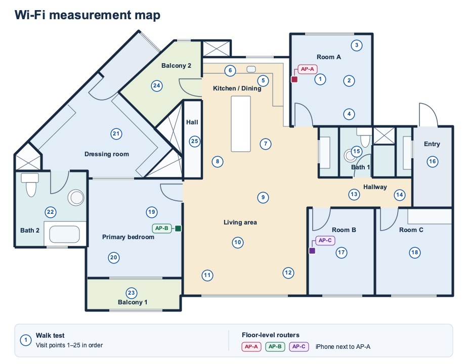
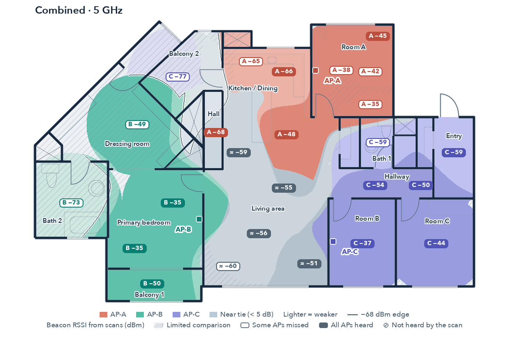

# Local Edge Agent

A personal AI agent that runs entirely on a MacBook Pro (Apple M4 Pro, 24 GB unified memory). It answers
questions about your documents and images, does engineering math, and diagnoses the Mac it runs on from its
own battery, power, thermal, memory and storage sensors. Every model runs locally through Ollama; nothing is
sent to a cloud service.

Author: PARK, SEHO

```
you> reports/apple_10k_2025.pdf Check that Apple's total assets equal total liabilities plus shareholders' equity.
agent> Apple's total assets at September 27, 2025, are $359,241 million [p.34]. The total liabilities are
       $285,508 million [p.34] and the total shareholders' equity is $73,733 million [p.34].
       285,508 + 73,733 = 359,241. This matches the total assets.

you> How is my battery health?
agent> Your battery health is good. The maximum capacity is 90% and the full-charge capacity is 86.0% of the
       design capacity. The battery has undergone 286 charge cycles, well below the 1,000-cycle threshold, and
       is operating at 30.5 °C. Charging is currently paused by macOS at 90% to maintain battery longevity.
       No action is needed.
```

Both answers are from recorded test runs, slightly shortened ([document run](evals/documents/runs/run45.md),
device Run D6).

**Contents**
- [Quick start](#quick-start)
- [User guide: what you can ask](#user-guide-what-you-can-ask)
- [How an answer is made](#how-an-answer-is-made)
- [How it was built](#how-it-was-built)
- [Status and roadmap](#status-and-roadmap)
- [Documentation](#documentation)

---

## Quick start

```bash
./scripts/setup_ollama.sh                  # Ollama via Homebrew
ollama pull qwen3:14b                      # documents and planning
ollama pull qwen3:8b                       # general questions and tools
ollama pull qwen3-vl:8b-instruct           # images and document pages
ollama pull qwen3:4b-instruct              # answers about the Mac
ollama pull qwen3:1.7b                     # routing when the keyword rules tie

python3 -m venv .venv && source .venv/bin/activate   # Python 3.11+
pip install -r requirements.txt

python main.py --fast                      # start a session
```

Type a question at `you>`. To ask about a file, put its path in the question. Ask in English or Korean; the
answer comes in the language of the question. Session commands: `/tools`, `/reset`, `/exit`.

---

## User guide: what you can ask

| Area | What it does | Typical time |
|---|---|---|
| [Engineering math and time](#1-engineering-math-and-time) | Calculations with units, decibels, complex numbers; dates and time zones | a few seconds |
| [Images](#2-images) | Describes an image; reads text, formulas and charts in it | 10-60 s |
| [Documents](#3-documents-pdf-and-powerpoint) | Answers from PDFs and slides with page citations; equations, tables, financial statements, charts | 1-2 min |
| [This Mac](#4-this-mac) | Battery, charging, energy mode, CPU, GPU, heat, memory, storage, ports, transfer speeds, which work fits now | 5-15 s |
| [Wi-Fi, network and Bluetooth](#5-wi-fi-network-and-bluetooth) | Where a slow connection comes from; verdicts for games, calls and streaming; coverage of the home's routers | 15-40 s |

### 1. Engineering math and time

**Covers:** engineering functions, formulas with physical units (with a check that the result has the
expected dimension), decibels and link budgets, complex numbers, number bases, physical constants, unit
conversion; the current time, time zones, adding to a date, the time between two dates, "next Friday".

**Example questions**
- `A 1,200 kg car brakes from 90 km/h to 0 in 40 m. What is the braking force?`
- `What is the equivalent resistance of 100 Ω, 220 Ω and 470 Ω in parallel?`
- `A 2 W transmitter, +10 dBi antenna, 100 dB path loss, +3 dBi receive antenna: received power in dBm?`
- `How long does a 2 kW kettle take to heat 1.5 L of water from 20 to 100 °C?`
- `What time is it in New York when it is 9 am in Seoul?`
- `What date is 100 days after March 3?`

**How it answers:** the model chooses a tool and its inputs; the tool computes. The model never does the
arithmetic itself.

**Tested:** seven unseen engineering problems, 6 right with `qwen3:14b` (Run 9). The miss, a link budget in
which watts were mistaken for dBm, led to a link-budget hint and more decibel conversions in the calculator.

### 2. Images

Put the image path in the question.

**Covers:** what an image shows; text in it (signs, labels, handwriting, comments), read twice at two zoom
levels and compared by code; formulas in LaTeX; charts; circuit boards and diagrams; counting and comparing.
It says "not shown" instead of inventing what the image does not contain.

**Example questions**
- `board.jpg What microcontroller is this board built around? Which GPIO pins go to the SD card?`
- `formulas.png Transcribe these formulas in LaTeX and explain what each one computes.`
- `ber_chart.png Which modulation needs the lowest Eb/N0 to reach a bit error rate of 10^-6?`
- `street.jpg Describe this photo. Where was it likely taken? Read any signs you can see.`
- `comments.png Read these comments and explain why the conversation is funny.`

**Tested:** 12 cases and 4 hallucination checks (questions about things that are not in the image): 4 fully
right, 7 mostly right, 1 wrong; hallucination checks 4 of 4 (Run 23). Details:
[evals/vision/cases.md](evals/vision/cases.md).

### 3. Documents (PDF and PowerPoint)

Put the document path in the question.

**Covers:** lecture slides and research papers (summaries, explanations, practice questions with answers);
numbered and unnumbered equations, read from the page image and checked; tables, financial statements and
charts, with ratios, totals and growth rates computed by code. Every statement cites its page as `[p.N]`. A
question the document does not answer gets "not in the document", only after a second search.

**Example questions**
- `notes/lecture4.pdf Summarize this lecture.`
- `notes/lecture4.pdf Make three exam questions with answers and the source pages.`
- `papers/paper.pdf Write equation (3) in LaTeX and explain each symbol.`
- `papers/paper.pdf What does equation (5) mean?`
- `reports/annual.pdf Compute the operating margin for 2025.`
- `reports/10k.pdf How much was spent on share repurchases and dividends, and how much in total?`
- `reports/ir.pdf From the chart on page 2, estimate the operating income in Q3 '25.`

**Tested** (each holdout on unseen documents, with the code frozen and run once):

| Test | Result |
|---|---|
| Lecture slides, holdout | 76% fully correct |
| Research papers, three holdouts | 38% → 62.5% → 74%, as search by page became search by passage |
| Equations: 28 read from six papers | 26 exact, 2 close, 0 wrong (Run 36) |
| Paper with numbered equations, holdout | 69% fully correct, none wrong (Run 41) |
| Tables, statements and charts (development set) | 48% → 87% (Runs 42-45) |
| "Not in the document" checks, all sets | 20 of 20 (Run 45) |

Every answer of these runs is published with its grade in [evals/documents/runs/](evals/documents/runs/).

### 4. This Mac

Ask about the machine in plain words. Keyword rules send the question to the battery agent or the performance
agent; general questions ("explain how lithium-ion batteries work") stay with the general assistant.

| Topic | What the agent can tell you | Example question |
|---|---|---|
| Battery | Health against Apple's limits (80%, 1,000 cycles), cycles, cell balance, temperature, time left, why it drains | `Do I need to replace my battery?` |
| Charging | Time to full, the adapter's rating against what it delivers, a battery that drains on the adapter, a charge held at the limit | `My charger is plugged in but the battery is going down` |
| Energy mode | Which mode to use on battery, with speeds measured on this Mac in each mode | `Which power mode should I use on battery?` |
| CPU and GPU | Use, clocks, power, the program holding the processor, a GPU held at its lowest clocks | `Which program is eating my CPU?` |
| Heat | macOS thermal pressure, chip power, the cause of heat | `Why is my Mac so hot?` |
| Memory | Memory available, swap, the apps holding the most memory, the local models loaded | `Which app is using the most memory?` |
| Storage and ports | Free space, SSD health, what is connected to the Thunderbolt and USB ports | `What is connected to my USB ports?` |
| Transfer speeds | Memory bandwidth and SSD read and write, measured in 5 s and compared with this Mac's normal | `Is my memory bandwidth normal?` |
| Work that fits now | Documents, 4K video, video calls, photo editing, coding, video editing, games, 3D rendering, model training: yes, with care or not now; on battery, for how long | `Can I edit 4K video now?` |

On the adapter, a battery answer covers health and heat; on battery it adds time left, drain, efficiency and
the energy mode. Fan speed and chip temperature have no public interface on this Mac, so the agent says they
are not measured instead of guessing. Screen brightness and keyboard light are left to the user.

**Full guide with example questions for every component:** [docs/device_questions.md](docs/device_questions.md).

**Tested:** 36 questions on recorded and live machine states. In the first run (D1) no answer was usable,
because the answer model wrote out its reasoning. In the sixth run (D6): 29 right, 7 mostly right, 0 wrong;
routing 40 of 40; live battery answers in 4.7 s, live performance answers in 14.7 s. Details:
[evals/device/results.md](evals/device/results.md).

### 5. Wi-Fi, network and Bluetooth

**Covers:** where a slow connection comes from, hop by hop: the radio link (signal, noise, SNR, modulation), the
Wi-Fi segment to the router (latency, spikes, loss), the internet beyond it, and DNS. Verdicts for games, video
calls, 4K streaming, browsing and messaging come from measured latency, loss and speed, not from the signal alone.
Which of the home's networks to use at the current place, from SNR and SINR.

**Example questions**
- `Why is my Wi-Fi slow?`
- `Is the problem my Wi-Fi or my internet provider?`
- `Can I play an online game on this Wi-Fi now?`
- `Is my internet connection good enough for a video call?`
- `How fast is my internet? Can I stream 4K?`
- `Which Wi-Fi should I use here?`
- `Is my Bluetooth speaker signal ok?`

**What the measurements found on this Mac**
- **Latency spikes come from AirDrop's radio (AWDL).** With AWDL switched off and on in 8 random-order pairs, the
  spikes to the router were lower with it off in 7 of 8 pairs; where it stayed off, the 95th-percentile latency
  fell from 60-170 ms to about 3 ms. The agent names it as the cause only when AWDL is active.
- **Measuring time is set by experiment:** 10 s gives the median latency within 0.4 ms; the 95th percentile needs
  30 s, so questions about games and calls measure for 30 s.

**Coverage survey of a home with three routers** (25 points, the Mac on a chair, all routers on the floor)

| Measurement map | Strongest router on 5 GHz |
|---|---|
|  |  |

- **Link adaptation, measured:** the modulation stepped down with the signal, from MCS 9 (256-QAM) above about
  -60 dBm to MCS 1 near -80 dBm. Every point at or above -68 dBm met the game and call criterion (p95 latency
  50 ms or less); below it, latency spikes appeared at some points (77-120 ms) and the first walk's weakest point
  (SNR 7) reached 243 ms. Messaging keeps working almost to the edge of coverage, while speed falls much earlier
  (download 433, 390, 298, 150 and 81 Mb/s from the router outwards).
- **Where the Wi-Fi drops:** the places where the Mac's own 5 GHz network cuts out in daily use (Room C, the
  entry, a bathroom) are all in another router's area, whose signal is 20-28 dB stronger there.
- **SNR and SINR:** two routers share their channels on both bands (5 GHz 44, 2.4 GHz 11). Counting the other
  router as noise gives a SINR near 0 dB in the living area, yet the Mac used 64-QAM to 256-QAM there: the routers
  hear each other and take turns (CSMA/CA), so the cost is airtime, not SINR. The agent therefore adds to the noise
  only networks heard below the 802.11 CCA level (-82 dBm).
- **Which network to use:** ranked from one scan (SINR, then the link rate expected from the measured
  rate-against-SNR table); a short test of each candidate when the difference is within the 5 dB spread of the
  measurement. Replayed on the survey, every point with latency spikes was advised to switch and no point advised
  to stay had them.
- **Repeatability:** the same points measured on two days differed by 3.0 dB RMS, which bounds how precisely any
  map can be checked.
- **The signal goes around the walls, not through them:** a model with one loss per wall on the straight line
  gave 12-14 dB error on held-out points. Routing the signal instead along the shortest way through open space and
  doors, with a loss per bend, gave 3-4 dB, better than interpolating the measurements (6-7 dB). It explains why
  the bathroom right below the router's room gets almost nothing: through the concrete wall it is 3.7 m away,
  around it 6.4 m with two bends. The maps stay interpolated from the measurements, as decided before the walks.
- **RSSI** is read as macOS reports it, in dBm converted by the chip's driver and not calibrated: absolute values
  are approximate, comparisons on the same Mac are reliable.

Wi-Fi coverage maps use inverse-distance weighting (IDW) to interpolate detected beacon RSSI separately for each
AP and band, using 7–24 readings from 25 survey points.

All maps (each router and band, both bands combined, and Bluetooth LE from an iPhone): [docs/images/wifi/](docs/images/wifi/).
Method, assumptions and results: [docs/wifi_method.md](docs/wifi_method.md). Experiments and decisions:
[evals/wireless/experiments.md](evals/wireless/experiments.md).

**Next, Stage 9:** ask the Mac's agent from an iPhone (Shortcuts and Siri); a battery-time model fitted on logged
discharge sessions.

### Limits

- Reading dense charts is the weakest part: two of the three wrong answers in Run 45 were chart readings.
- Scores on sets used during development are upper bounds; the holdout results above are the honest ones.
- The device agent reads what macOS exposes without extra drivers: no fan speed, no chip temperature.

---

## How an answer is made

```
question --> router (keyword rules; a small model only if the rules tie)
               |
   +-----------+------------+----------------+------------------+
   v           v            v                v                  v
 tools       image        document         battery          performance
 (math,      planner      planner          agent            agent
  time)      (vision)     (pages, cites)   (sensors)        (sensors, 10 s capture)
   |           |            |                |                  |
   +-----------+------------+-------+--------+------------------+
                                    v
            code does the exact work: computes, reads twice and compares, checks citations,
            diagnoses from thresholds and rules
                                    v
            a local model writes the answer from the structured result
                                    v
            code checks the answer: every number must be in the measurements or the document;
            a failed answer is rewritten once, then replaced by a template
```

The rule behind it: **a model explains, code decides.** The battery answer at the top was written from this
report, which code built from the sensors (shortened):

```text
Facts:
- maximum capacity (macOS): 90%
- full-charge capacity / design capacity: 86.0% (5,372 of 6,249 mAh)
- charge cycles: 286 of 1,000 rated
- battery temperature: 30.5 °C
- charging held by macOS: yes, at 90% (charger status 0x1000000)
Findings (most severe first):
- [info] Battery health is good. Advice: No action needed.
- [info] Charging is paused by macOS. Advice: Normal: macOS holds the charge below full to protect the battery.
```

The agent core uses only the Python standard library. Tools, profiles, code layout and every test command:
[docs/development.md](docs/development.md).

---

## How it was built

### Method

Every part goes through the same loop:

1. **Design note first:** the problem, two or three options, the choice and its reason
   ([docs/stage7_design.md](docs/stage7_design.md)).
2. **Test set and prediction before the run:** questions with expected answers, and a pass gate written down
   before running.
3. **Run and grade:** automatic checks (route, findings, numbers) and hand grading as ✅ / ⚠️ / ❌. Answers are
   published with their grades.
4. **Fix the cause in code, not in the prompt,** and add an offline test for it.
5. **Rerun the full set**, not only the failing cases, to catch regressions.
6. **Holdout once:** unseen documents or problems, code frozen, one run.

375 offline tests run without Ollama, using a scripted fake model and recorded hardware outputs.

### Problems found and how they were fixed

| Problem seen in a run | Cause | Fix |
|---|---|---|
| The model ignored rules written in its prompt (Runs 13-17) | A prompt rule is only a suggestion to a small model | Each rule that matters moved into code ([docs/guardrails.md](docs/guardrails.md)) |
| More checking made image answers worse and 3-4× slower (Run 24) | Two looks that agreed were shown as correct even when both were wrong | Checks must be independent; agreement is not presented as correctness |
| Two equation readings agreed and were both wrong (Run 34) | Both came from the same bad crop | Better crops, the more complete reading kept, a third call checks against the image: 0 wrong (Run 36) |
| Papers holdout at 38% (Run 29) | Search by page does not fit long papers | Search by passage (sections, tables, captions): 62.5%, then 74% |
| A test run at a third of its normal speed (Run 45) | GPU held at its lowest clocks by thermal management, not by heat | A speed check before long runs; the performance agent detects this state |
| "Your charger is too weak" with 72 of 100 W in use (Run D3) | The rule fired on any battery drain on the adapter | Compare with the adapter's rating first; the drain came from the 90% charge limit |
| A list of Korean terms in the prompt added wrong remarks (Run D4) | Everything in a prompt is an input the model may use | Only the terms in the report are given; the wrong remarks disappeared (Run D5) |
| A memory shortage blamed on other apps (Run D6) | The agent's own models filled the memory | The agent reads the models it has loaded and counts them |
| "Transfer speeds are fine" although nothing measured them | The writer repeated the subject of the question | Unmeasured quantities are reported as unmeasured; a 5 s benchmark was added |
| Energy per job unreadable on battery (run E2) | The system energy counter does not follow the load on battery (step test) | Measure the battery's charge drop instead, with a noise check |

The full history, with dates and every run: [docs/devlog.md](docs/devlog.md).

### Measurements behind the device agent

- **Energy modes:** generating tokens is limited by memory bandwidth (about 230 of 273 GB/s), so High Power is
  no faster than Automatic and Low Power is 35-45% slower ([evals/device/energy.md](evals/device/energy.md)).
- **Workloads:** 15 synthetic everyday workloads (video, calls, compiling, games, rendering, training)
  measured on the adapter and on battery; the "work that fits now" answers come from them
  ([evals/device/workloads.md](evals/device/workloads.md)).
- **Power controller:** a PI controller paces model training to hold the chip at a set power: the mean stays
  within 0.1 W of the target and enters the ±10% band after 3-5 s
  ([evals/device/controller.md](evals/device/controller.md)).

---

## Status and roadmap

| Stage | Content | State |
|---|---|---|
| 0-2 | Agent loop, tool calling, time and engineering math tools | Done |
| 3 | Images: question planner, two-reading text check | Done |
| 4-6 | Documents: cited answers, equations, tables, statements and charts | Done (one holdout pending) |
| 7 | This Mac: sensors, battery and performance agents, energy policy, workloads, power controller | Done |
| 8 | Network agent, Wi-Fi experiments (W1-W3), coverage survey of three routers, Bluetooth LE | Done (11-19) |
| 9 | iPhone client, battery-time model | Next |
| 10 | Results, plots, demo | Planned |

Dates and "done when" criteria: [docs/roadmap.md](docs/roadmap.md).

## Documentation

| Document | Content |
|---|---|
| [docs/device_questions.md](docs/device_questions.md) | User guide for questions about the Mac, its network and Bluetooth |
| [evals/wireless/experiments.md](evals/wireless/experiments.md) | Wi-Fi and Bluetooth experiments: predictions, results, decisions |
| [docs/development.md](docs/development.md) | Tools, profiles, code layout, all test commands |
| [docs/devlog.md](docs/devlog.md) | Development log: decisions, runs, fixes |
| [docs/guardrails.md](docs/guardrails.md) | Every rule enforced in code, with the run that motivated it |
| [docs/benchmarks.md](docs/benchmarks.md), [docs/findings.md](docs/findings.md) | Runs 1-45: speed, tools, vision, documents |
| [evals/](evals/) | Test sets, results and published answers |

## License

MIT License. See [LICENSE](LICENSE).
